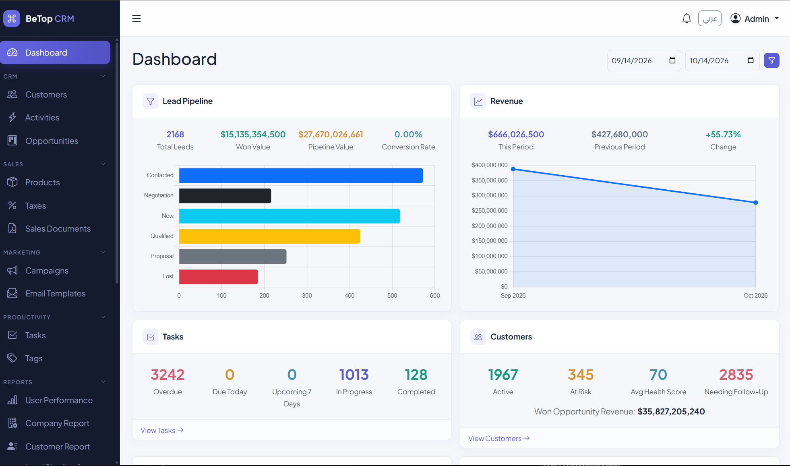
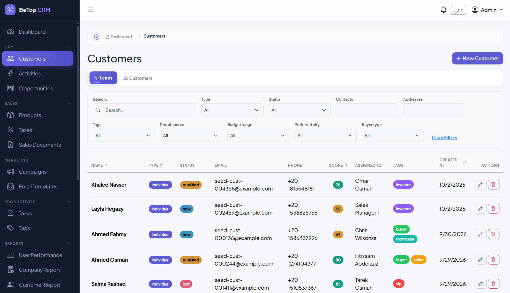
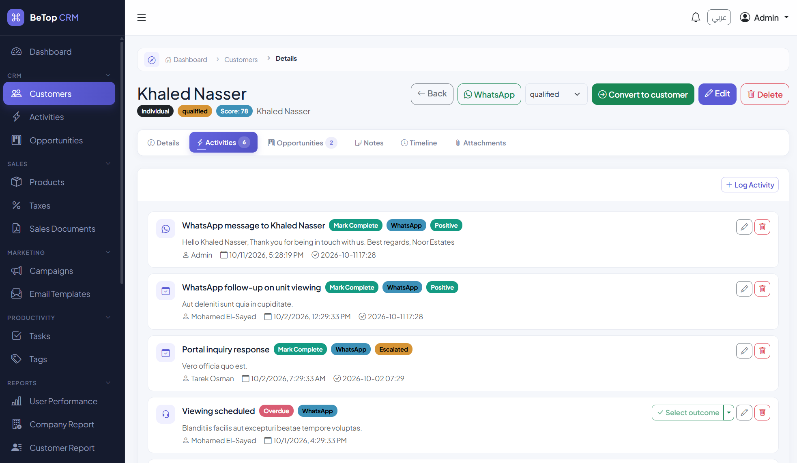
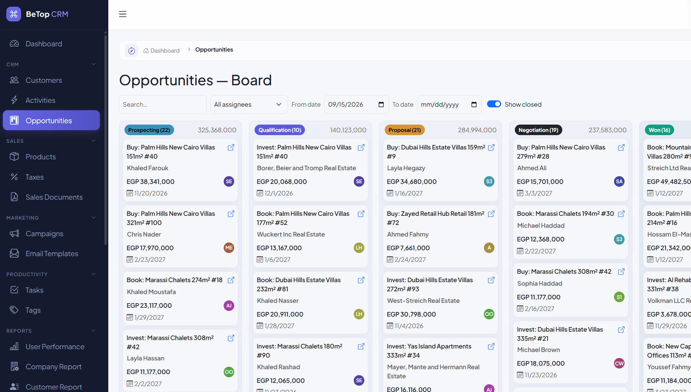
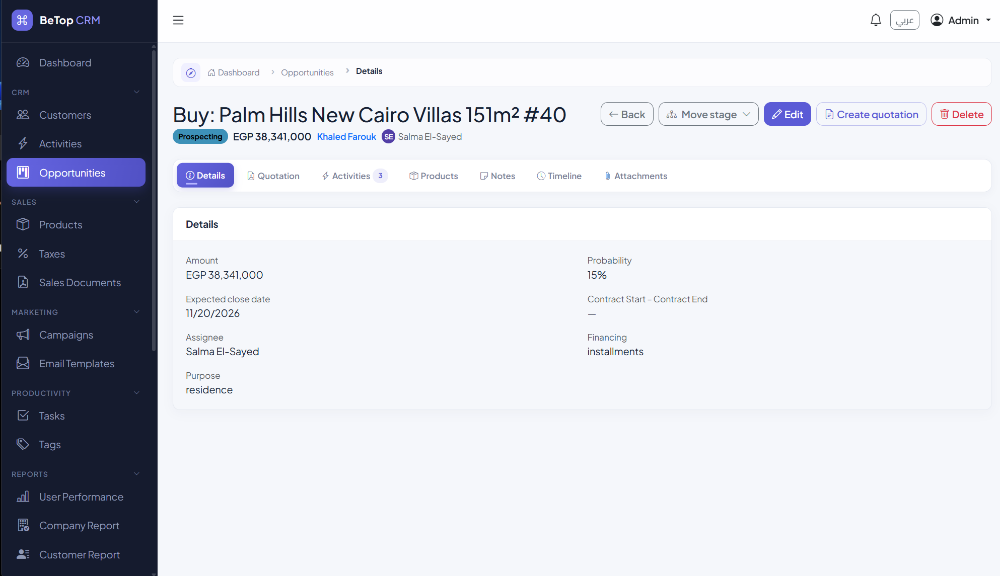
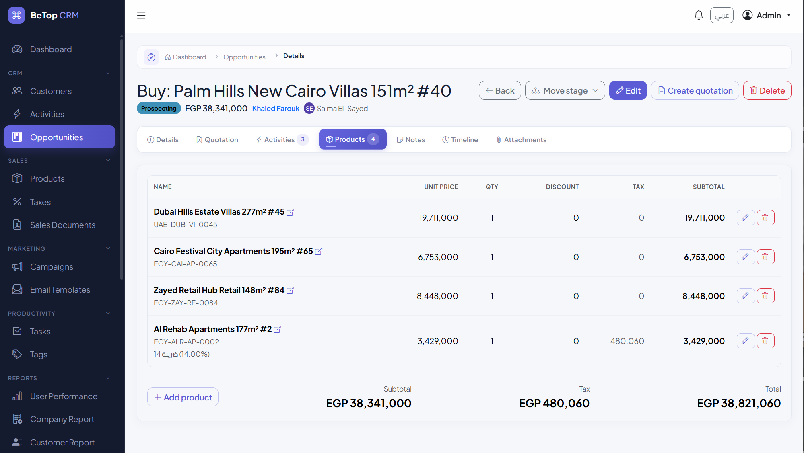
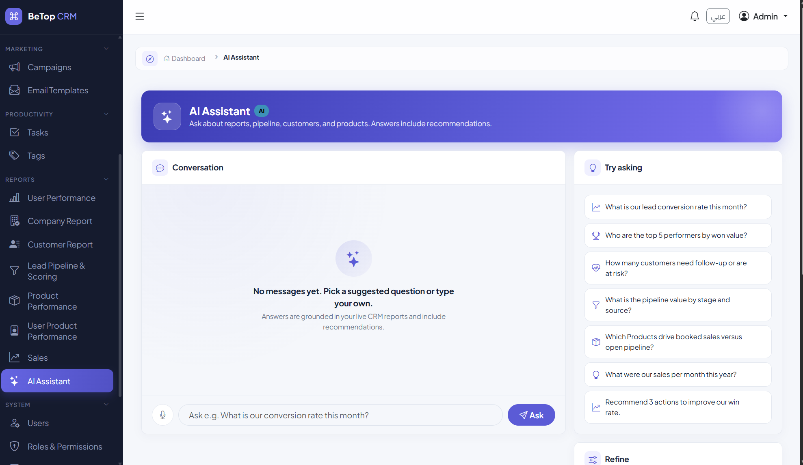

# BeTop CRM

An open-source, API-first CRM built with **Laravel 13** and a **Vue 3** single-page frontend. It covers the full sales cycle: customers and leads, opportunities and pipeline, quotations, invoices, tasks, campaigns, reporting and more. It is fully bilingual (**English / Arabic**, with complete RTL support).


---

## Features

**Sales**
- **Customers & leads**: individuals or companies, multiple contacts and addresses, lead scoring, tags and custom fields
- **Opportunities**: staged pipeline (Prospecting → Qualification → Proposal → Negotiation → Won / Lost) with a Kanban board, contract terms and product line items
- **Quotations & invoices**: tax and discount handling, PDF generation (including Arabic), email and WhatsApp delivery
- **Products catalog** with categories and taxes

**Productivity**
- Activities and notes on customers and opportunities, with outcomes and follow-ups
- Tasks, notifications and a unified activity timeline
- Global search across all entities
- Role-based dashboard with pipeline and revenue insight

**Communication**
- Email templates and queued bulk campaigns
- Outbound WhatsApp messaging (Meta Cloud API)
- Outbound webhooks
- AI-assisted email generation and AI chat (via `laravel/ai`)

**Platform**
- Roles and granular permissions (`view-leads`, `update-opportunities`, …) with custom roles
- Append-only audit log
- File attachments
- Queued CSV import / export
- Report exports
- Company and per-user settings

**Internationalisation**
- English and Arabic UI, backend messages and PDFs, with automatic LTR/RTL switching

---

## Screenshots

**Dashboard**: pipeline, revenue, tasks and customer health at a glance



**Customers & leads**: filterable list with lead scores, tags and assignees



**Customer activities**: calls, emails, WhatsApp and meetings with outcomes and follow-ups



**Opportunity board**: Kanban pipeline with value totals per stage



**Opportunity detail**: guided stage changes, quotations and invoices



**Products on an opportunity**: line items with discounts and taxes



**AI assistant**: ask questions about your live CRM reports



---

## Tech Stack

| Layer | Technology |
|---|---|
| Backend | PHP 8.3+, Laravel 13, Sanctum 4 (session-cookie SPA auth), Spatie Permission |
| Frontend | Vue 3 (`<script setup>`), TypeScript, Pinia, Vue Router, vue-i18n, Bootstrap 5, Vite |
| Database | MySQL 8+ (tests also use MySQL) |
| Queue | Laravel database queue |
| PDF | DomPDF with Arabic shaping (`ar-php`) |
| Testing | Pest 4, Playwright (E2E) |
| Code style | Laravel Pint |

---

## Getting Started

### Requirements

- PHP 8.3+ with the usual Laravel extensions
- Composer 2
- Node.js 20.19+ and npm
- MySQL 8+

### Installation

```bash
git clone https://github.com/ahmedmagdy89w/BeTopCRM.git
cd BeTopCRM

cp .env.example .env
# edit .env: set DB_DATABASE / DB_USERNAME / DB_PASSWORD

composer install
php artisan key:generate
php artisan migrate --seed

npm install
```

`composer run setup` runs the install, key generation, migration and build steps in one go. It does not seed, so run `php artisan db:seed` afterwards.

### Run in development

```bash
composer run dev
```

This starts the Laravel server, the queue worker and the Vite dev server together. Open <http://localhost:8000>.

### Default login

The seeder creates an administrator. Set `ADMIN_EMAIL` and `ADMIN_PASSWORD` in `.env` before seeding to choose your own; otherwise these defaults apply:

| Email | Password |
|---|---|
| `admin@example.com` | `password` |

> **Change this password immediately** on any environment that is reachable from a network.

### Production build

```bash
npm run build
php artisan config:cache route:cache
php artisan queue:work --tries=3   # run under a process manager such as Supervisor
```

---

## Configuration

Key `.env` settings (see [.env.example](.env.example) for the full list):

| Variable | Purpose |
|---|---|
| `APP_LOCALE` | Default language (`en` or `ar`) |
| `DB_*` | Database connection |
| `SANCTUM_STATEFUL_DOMAINS` | Domains allowed for cookie authentication; must include your frontend host |
| `QUEUE_CONNECTION` | Defaults to `database`; imports, exports, webhooks and campaigns need a running worker |
| `MAIL_*` | Mail transport (defaults to `log`) |
| `WHATSAPP_*` | Meta WhatsApp Cloud API credentials (optional) |

AI features are configured through the `laravel/ai` package and the in-app settings; they are optional.

---

## Roles & Permissions

Three roles are seeded: **admin**, **manager** and **sales_rep**. Access is controlled by granular permissions rather than role checks, so you can create custom roles in the UI. Authorization is enforced by policies on every controller action.

---

## Architecture

The backend follows a strict layered design:

```
Request → Form Request (validation) → Controller (authorize) → Service (logic) → API Resource
```

- Thin controllers: authorize, call one service method, return a Resource
- Business logic in `app/Services/`
- Filterable queries in `app/Filters/`
- Policies for authorization, with auditing through an `Auditable` trait
- All routes are versioned under `/api/v1`

The frontend lives in `resources/js/`:

```
components/   base/ (presentational), form/, shared/
composables/  reusable stateful logic (use*)
services/     typed API clients on a shared Axios instance
stores/       Pinia, global state only (auth, UI, notifications, tags)
views/        route-level pages, lazy-loaded
i18n/locales/ en.json, ar.json
```

---

## Documentation

Detailed specifications live in [docs/spec/](docs/spec/README.md): domain model, API endpoints, validation rules, services, permissions, and the [frontend spec](docs/spec/frontend-spec.md).

---

## Testing

Backend tests use `.env.testing` and `phpunit.xml`, which expect a MySQL database named `crm_test` and the `root` user with password `root`. Create the database, or adjust both files to match your setup. The `APP_KEY` in `.env.testing` is a throwaway test key; never reuse it, and never commit your real `.env`.

E2E tests use `E2E_EMAIL`, `E2E_PASSWORD` and `E2E_BASE_URL`. All three are optional and default to `e2e.admin@example.com`, `Password123!` and `http://127.0.0.1:8000`.

```bash
# Backend
php artisan test --compact
php artisan test --compact --filter=QuotationTest

# Frontend type-check and build
npm run build

# End-to-end (Playwright)
npx playwright install
npm run test:e2e

# Code style
vendor/bin/pint
```

---

## Contributing

Contributions are welcome.

1. Fork the repository and create a feature branch.
2. Read [AGENTS.md](AGENTS.md) and the relevant spec in `docs/spec/`; they define the project conventions.
3. Add or update tests for every behaviour change.
4. Run `vendor/bin/pint` and `php artisan test` before opening a pull request.
5. Keep user-facing strings translated in both `en` and `ar`, and make sure the UI works in RTL.

Please report security issues privately as described in [SECURITY.md](SECURITY.md) rather than through public issues.

---

## Authors

Created and maintained by [@ahmedmagdy89w](https://github.com/ahmedmagdy89w). See [CONTRIBUTORS.md](CONTRIBUTORS.md) for everyone who has helped.

---

## License

Released under the [MIT License](LICENSE).
